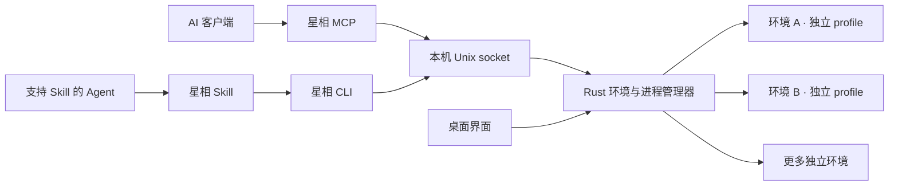

# AI 管理星相与批量浏览器

核对日期：2026-11-18。当前内核：本机 Camoufox `159.0-beta.42`。Google 官方项目是 `ChromeDevTools/chrome-devtools-mcp`；本次 GitHub API 返回 57,988 stars。当前 README 已同时提供 MCP、CLI 和 Skills。

## 方案表

✓ 表示方案可承担这一层；不表示全部已经在星相实现。“网页操作”指页面快照、点击、填表等，区别于启动浏览器进程。

| 方案 | 管理星相环境 | 操作 Camoufox 网页 | 批量独立环境 | 结论 |
| --- | --- | --- | --- | --- |
| 星相自有 MCP / CLI / Skill | ✓ | — | ✓ | 已实现并通过真实测试，负责配置和进程管理 |
| 星相 MCP + WebDriver BiDi 适配 | ✓ | ✓ | ✓ | 本机 159 已实测 BiDi 页面读取；尚未接入产品，优先评估此路线 |
| 星相 MCP + 每环境 Playwright worker | ✓ | ✓ | ✓ | 推荐后续网页操作架构，尚未实现 worker |
| 微软 Playwright MCP + 本地 Camoufox 启动 | — | ✓ | ✓ | 可适配路线，需逐环境配置与持久化验证；本项目尚未接入 |
| Google Chrome DevTools MCP / CDP | — | — | — | 官方支持 Chrome / Chrome for Testing；当前 Firefox 系 Camoufox 无法直接使用 |
| 桌面截图、无障碍树和鼠标操作 | ✓ | ✓ | ✓ | 已用于本次桌面验收，适合人工可见流程和兜底，批量任务效率较低 |

如果以后增加 Chromium 内核，可增加 CDP 适配，并把 Google 官方 MCP 分别连接到各环境自己的调试端口。它的 `pageId` 路由解决页面选择，不会自动成为星相的环境、代理和进程管理器。Tauri 在 macOS 使用系统 WebView，当前管理器也不是一个可直接附加 Chrome CDP 的 Chrome 页面。

2026-11-18 已实际对照：Google MCP 与 Playwright 的 CDP 连接本机 Camoufox 均失败，连接临时 Chrome 成功。Camoufox 的同类端口实际提供 WebDriver BiDi，会话和页面读取已成功。Firefox 自 141 起移除了旧版 CDP 实现；“可被自动化”与“支持 CDP”是不同判断。详见 [协议与指纹实测](protocol-and-fingerprint-audit.md)。

## 已实现的三个入口

三者共用桌面进程中的 Rust 管理逻辑：



- MCP：供 AI 客户端发现并调用有参数校验的工具。
- CLI：供终端和脚本调用相同功能，输出 JSON。
- Skill：告诉 Agent 如何选择环境、调用工具和核对结果，本身不运行浏览器。
- CDP：Chrome 的底层调试协议；与 MCP 是不同层次。当前星相管理接口不暴露 CDP。

### 使用 CLI

先启动新版星相桌面应用，在项目根目录执行：

```sh
npm run cli -- status
npm run cli -- list
npm run cli -- create --json '{"name":"本地测试","os":"Windows"}'
npm run cli -- update <环境ID> --json '{"language":"en-US"}'
npm run cli -- start <环境ID1> <环境ID2>
npm run cli -- stop <环境ID1> <环境ID2>
npm run cli -- archive <环境ID>
npm run cli -- restore <环境ID>
npm run cli -- skill
```

`list --all` 包含归档，`list --query 关键词` 搜索名称或 ID，同时返回分组、代理与真实运行状态。创建默认直连；修改字段见 `skills/starpersona/SKILL.md`。批量 start / stop 逐项执行，失败项标记 `ok: false`，退出码为 1。不要把整批结果当成全部成功。

启动返回仅表示创建了进程；刚启动的内核可能尚未准备好接受退出请求，按错误提示稍后重试。关闭返回仅表示已请求正常退出，使用 `status` 确认对应环境从 `browser.instances` 消失。系统退出确认或网页未保存提示可能让进程继续等待，不能用强杀替代核对。

### 使用 MCP

项目使用官方 `@modelcontextprotocol/sdk`，通过标准 stdio 通信，不对外开放 HTTP 服务。配置示例见仓库根目录 `mcp-config.example.json`；把示例中的 `/absolute/path/to/StarPersona` 替换为你本机项目的绝对路径。

```json
{
  "mcpServers": {
    "starpersona": {
      "command": "node",
      "args": ["/absolute/path/to/StarPersona/scripts/starpersona-mcp.mjs"]
    }
  }
}
```

| MCP 工具 | 功能 |
| --- | --- |
| `starpersona_status` | 内核版本、真实 PID、关闭中状态、错误 |
| `starpersona_profiles` | 查询环境、分组、代理与运行状态 |
| `starpersona_profile_create` | 创建独立环境配置，默认直连 |
| `starpersona_profile_update` | 修改允许的配置字段 |
| `starpersona_profile_start` | 启动指定环境 |
| `starpersona_profile_stop` | 请求指定托管进程正常退出 |
| `starpersona_profile_archive` | `archived: true` 归档，`false` 恢复 |

客户端能完成 MCP 初始化和列出工具时，不代表桌面管理器已运行。实际调用会检查本机接口；桌面未打开时会明确报错。CLI / MCP 的更改会通知界面刷新，界面保存时检查旧版本，防止覆盖其他入口的新配置。

当前本机接口支持 macOS / Linux 的 Unix socket，文件权限为 `0600`，只供本机当前用户访问；不绑定任何网络端口。Windows 的本地命名管道尚未实现。macOS 关闭已验收，Linux 当前需从浏览器窗口正常退出。

### 使用 Skill

技能文件：`skills/starpersona/SKILL.md`，已通过 skill-creator 校验。可将整个 `starpersona` 技能目录放入所用 Agent 支持的 skills 目录，或直接让 Agent 读取该文件。CLI 的 `skill` 命令输出其本机位置。

本次没有修改任何 AI 客户端的全局 MCP 或 Skill 配置；仓库提供可接入的文件和示例。

## Camoufox issue 对方案的影响

以下是上游记录，不等同于已在本机版本复现；本次没有运行故意卡死网页的测试。

| 上游记录 | 核对内容 | 本项目采用的处理 |
| --- | --- | --- |
| #327（已关闭） | `firefox.connect_over_cdp` 报仅支持 Chromium；讨论改用 `firefox.connect` | 不把 Firefox 的 Playwright 端点当成 CDP |
| #398（已关闭的 PR）及当前 `server.py` | 维护者更正说明：persistent context 没有最终获得远程服务器支持；当前源码明确拒绝 `persistent_context` 和 `user_data_dir` | 不采用 `launch_server` 暴露持久化环境的方案 |
| #553（开放） | 较旧版本报告并发创建 context / page 卡住；讨论建议串行化 | 后续按环境独立进程，同环境建立操作队列；不能仅凭报告认定本机版本仍复现 |
| #720（开放） | 报告长时间脚本执行无法中断；后续复现指出影响范围与内容进程配置有关 | 后续限制单次执行、隔离任务错误；恢复不能静默删除 profile 或丢弃会话 |

推荐的下一步是优先评估已证实可用的 WebDriver BiDi，或由 Rust 统一管理每环境 Playwright worker 的生命周期。两条路线均向统一 MCP 提供按 `profileId + pageId` 定位的快照、导航、点击、输入与截图。Playwright worker 可使用 `firefox.launchPersistentContext` 或 Camoufox 的本地持久化 API。

自动化 worker 必须从启动时持有浏览器连接。不能把已经按普通模式启动的 Camoufox 假定为可随时 CDP 附加；也不能让普通模式和 worker 同时写同一 profile。切换模式应先正常关闭，复用同一独立数据目录后重新启动。

本轮交付到环境管理层；网页操作 worker、Playwright MCP 兼容性、CDP 适配均未实现，`status.pageAutomation` 明确返回 `false`。

## 验证与来源

已完成官方 MCP SDK 客户端握手、7 工具发现、参数校验、错误回传，以及真实桌面环境的创建、修改、启动、关闭和运行中保护。测试详情见 `browser-testing.md`，本机证据在 `.artifacts/ai-control-evidence.json`。

- Google 官方项目：<https://github.com/ChromeDevTools/chrome-devtools-mcp>
- Google 连接和并发说明：<https://github.com/ChromeDevTools/chrome-devtools-mcp/blob/main/docs/advanced-usage.md>
- Microsoft Playwright MCP：<https://github.com/microsoft/playwright-mcp>
- Playwright BrowserType：<https://playwright.dev/docs/api/class-browsertype>
- Camoufox #327：<https://github.com/daijro/camoufox/issues/327>
- Camoufox #398 与维护者更正：<https://github.com/daijro/camoufox/pull/398>
- 当前服务器实现：<https://github.com/daijro/camoufox/blob/main/python/src/camoufox/server.py>
- Camoufox #553：<https://github.com/daijro/camoufox/issues/553>
- Camoufox #720：<https://github.com/daijro/camoufox/issues/720>

本机研究快照保存在 `.artifacts/research/`；上游状态与 stars 会随时间变化。
